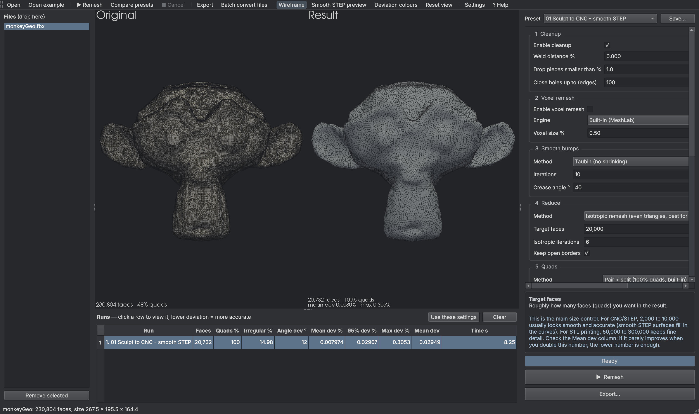

# Step Converter

Step Converter is a free Windows app that **converts 3D models** between **STEP, STL, OBJ, FBX, glTF, GLB and PLY**. It also **turns dense sculpts into clean quads**, such as ZBrush characters, Blender sculpts and scans. These export as smooth, watertight **STEP solids for CAD/CNC** or as tidy **STL for 3D printing**.

- Drag in a sculpt, pick a preset and press **Remesh**. You get a 100% quad mesh, and the app measures how closely it matches the original.
- **Smooth STEP**: every quad becomes a curved CAD surface, joined into one closed solid that CAM software accepts as a body.
- **Compare presets** side by side, using accuracy numbers instead of guesswork.
- Every setting is explained in the app. Point at a setting to read what it does, or press **F1** for the full [user guide](docs/USER_GUIDE.md).



*The example sculpt `samples/monkeyGeo.fbx` remeshed with preset 01 and Target faces 20,000. The result is 20,732 faces, 100% quads, within 0.008% of the original on average.*

No Blender, CAD program or other software is needed. Blender and Instant Meshes are optional extras.

---

## Download and install

Pick **one** of these three options.

| | Option | Best for | What you download |
|---|---|---|---|
| **1** | **Installer** | Most people | `StepConverter-Setup-<version>.exe` |
| **2** | **Single-file app** (no install) | USB sticks, PCs where you can't install | `StepConverter.exe` (or the `StepConverter-portable-<version>.zip` folder version) |
| **3** | **Clone the repo** | Developers, and anyone who wants the latest code or the command line | `git clone` (see below) |

Options 1 and 2 are on the **[Releases page](https://github.com/shaguru/Step-Converter/releases/latest)**. They are built automatically by GitHub Actions, and Python is already included.

### Option 1: Installer

1. Download `StepConverter-Setup-<version>.exe` from [Releases](https://github.com/shaguru/Step-Converter/releases/latest).
2. Run it. If Windows SmartScreen says *"Windows protected your PC"*, click **More info → Run anyway**. The app isn't code-signed yet.
3. Start **Step Converter** from the Start menu or the desktop shortcut.
4. To uninstall, use *Settings → Apps* in Windows.

### Option 2: Single-file app (portable)

1. Download `StepConverter.exe` from [Releases](https://github.com/shaguru/Step-Converter/releases/latest) and put it anywhere.
2. Double-click it. The **first start takes up to a minute**, because Windows unpacks the app into a temporary folder each time it starts. Later starts are faster.

If you use it often, take **`StepConverter-portable-<version>.zip`** instead. Unzip it anywhere and run `StepConverter.exe` inside the folder. It starts in a few seconds and also needs no install.

### Option 3: Clone the repository

You need [Git](https://git-scm.com/download/win), and either Python 3.12 from [python.org](https://www.python.org/downloads/) or Anaconda.

```bat
git clone https://github.com/shaguru/Step-Converter.git
cd Step-Converter
setup.bat
```

- `setup.bat` creates a private Python environment in `env\` and installs everything. It needs about 1.5 GB and takes a few minutes, and you only run it once.
- Then double-click **`Step Converter.bat`** to start the app.
- To update later, run `git pull` and then `setup.bat` again.

---

## Try it: the monkey example

The repo and every download include an example sculpt, **`samples\monkeyGeo.fbx`** (230,000 faces).

1. Open Step Converter and click **Open example** in the toolbar. That loads `samples\monkeyGeo.fbx`; you can also drag it onto the window.
2. In **Preset**, choose **01 Sculpt to CNC - smooth STEP**.
3. Press **▶ Remesh** (F5). In a few seconds you get about **4,250 quads (100% quads)**, within about **0.03%** of the original on average.
4. Turn on **Smooth STEP preview** and **Wireframe** to see the CAD surfaces the STEP will contain. **Deviation colours** shows where the result differs from the sculpt: blue is close, red is furthest.
5. Tick **STEP** and **STL** under *Export* and press **Export…**. You get a single solid STEP (about 6.5 MB) and an STL.

Next, try **Compare presets…** with presets 01, 02 and 04, and compare the rows in the **Runs** table.

---

## How it works (short version)

Each remesh runs seven stages. Each stage is a box in the settings panel.

| Stage | What it does | The setting to try first |
|---|---|---|
| 1 Cleanup | Welds duplicate points, removes crumbs, fills small holes | *Close holes up to* |
| 2 Voxel remesh (optional) | Rebuilds the model as one closed skin, like Blender's voxel remesh | *Voxel size %* |
| 3 Smooth bumps | Removes noise and sculpting texture | *Iterations* |
| 4 Reduce | Brings the face count down | **Target faces** (the main size and accuracy control) |
| 5 Quads | Turns triangles into quads (100% quads with the built-in method) | *Method* |
| 6 Relax + snap | Evens out the quads and snaps them back onto the surface | *Snap to* |
| 6b Flat faces (optional) | For hard-surface models: makes flat regions exactly flat and writes each as one CAD face in STEP | *Exact flat faces* |
| 7 Measure | Compares with the original and fills in the Runs table | |

The **[user guide](docs/USER_GUIDE.md)** explains every setting: what it does, what raising or lowering it changes, and good values for CNC and for 3D printing. It also covers recipes, how to read the Runs table, STEP options and troubleshooting. The app shows the same guide under **? Help** (F1).

### The Runs table in one line each

- **Mean dev %**: average distance from the original, as a % of model size. This is the main accuracy number; for CNC, under 0.02% is excellent.
- **95% dev % / Max dev %**: how far the worst parts are.
- **Quads %**: smooth STEP needs 100.
- **Irregular %**: points without exactly 4 edges (poles). Lower means cleaner edge loops.

---

## Optional extras

- **Blender** 3.x to 5.x: enables the *Blender QuadriFlow* quad method (flowing edge loops) and the Blender voxel engine. It is found automatically in `C:\Program Files\Blender Foundation`; otherwise set it in **Settings…**.
- **Instant Meshes**: put `Instant Meshes.exe` in the `tools\` folder next to the app, or in `%APPDATA%\StepConverter\tools`, or set it in **Settings…**.

---

## Command line (cloned version)

```bat
stepfable-cli remesh  in.fbx  out.step out.stl --preset "presets\01 Sculpt to CNC - smooth STEP.json" --set target_faces=5000
stepfable-cli convert in.obj  out.glb out.fbx
```

Options: `--step-mode smooth|auto|triangles`, `--unit MM|CM|M|INCH`, `--scale 10`, `--report report.json`.

---

## Notes and limits

- FBX import keeps quads and each object's position, rotation and scale. Materials, rigs and animation are ignored. FBX export writes static geometry (binary FBX 7.4).
- glTF, GLB, STL and PLY can only store triangles, so quads are split when you export to them.
- STEP files are much larger than STL. For CNC, 2,000 to 20,000 smooth quads is usually plenty. Above 100,000 faces the app asks before writing STEP.
- Tested on Windows 10 and 11, 64-bit.

---

## For developers

```
stepfable/
  app.py            desktop UI (PySide6 + PyVista)
  help_text.py      every setting's explanation (tooltips, help box, user guide)
  remesh.py         the 7-stage pipeline and its parameters
  quadify.py        triangle pairing, all-quad split, relax and surface snapping
  smooth_surface.py quad mesh to smooth bicubic patches (smooth STEP and preview)
  step_fast.py      fast direct STEP writer (watertight B-rep solids)
  step_io.py        STEP reading, and an OpenCASCADE writer kept as a fallback
  fbx_reader.py / fbx_writer.py / io_formats.py   the other formats
  metrics.py        deviation and quad-quality numbers
  external.py       Blender and Instant Meshes bridges
  tasks.py          heavy jobs run in a worker process (keeps the UI responsive; Cancel works)
docs/       USER_GUIDE.md (its settings section is generated: python scripts/build_docs.py)
packaging/  PyInstaller spec and Inno Setup script
presets/  samples/  tests/  tools/
```

- Run the tests: `env\Scripts\python -m pytest tests`
- If you edit `stepfable/help_text.py`, run `env\Scripts\python scripts\build_docs.py` to refresh the guide.
- **Releases**: push a tag such as `v0.2.0`, or run the *Build Windows release* workflow by hand (Actions tab → Run workflow, tick *draft release*). GitHub Actions builds the installer, the single-file exe and the portable zip, then attaches them to a **draft** release. Check it, then press *Publish*.
- To build locally: `env\Scripts\pip install pyinstaller` and then `env\Scripts\pyinstaller packaging\step_converter.spec`. The installer also needs [Inno Setup 6](https://jrsoftware.org/isinfo.php): run `iscc packaging\installer.iss`.

## Licence

GPL-3.0. See [LICENSE](LICENSE). Step Converter uses PyMeshLab (GPL-3), OpenCASCADE via cadquery-ocp (LGPL-2.1), PySide6/Qt (LGPL-3), VTK/PyVista (BSD), trimesh (MIT), ufbx (MIT) and assimp (BSD).
